# C1 review (Spike): welche Designrichtung?

**Neu:** US1, FR-001–FR-010, FR-012–FR-014: Startseite und „Lead prüfen“ in zwei Richtungen, Schrift Atkinson Hyperlegible Next (selbst gehostet), Palette Waldgrün, alles über Design-Tokens. Texte, Rollen, Abläufe und Daten unverändert.

**Wo:** <https://t-03hb8ajt4bi1nwl4wvcn69zwf-p27112.onamp.dev/> = „Ruhig“, <https://t-03hb8ajt4bi1nwl4wvcn69zwf-p27112.onamp.dev/?design=guided> = „Geführt“ (Amp-Portal, nur solange die Orb läuft; lokal: `pnpm build && pnpm preview`, dann `/?design=guided`).

| | Vorher | Ruhig | Geführt |
| --- | --- | --- | --- |
| Start, Desktop | 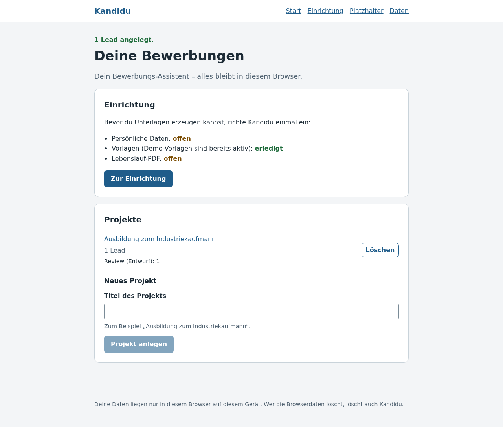 | 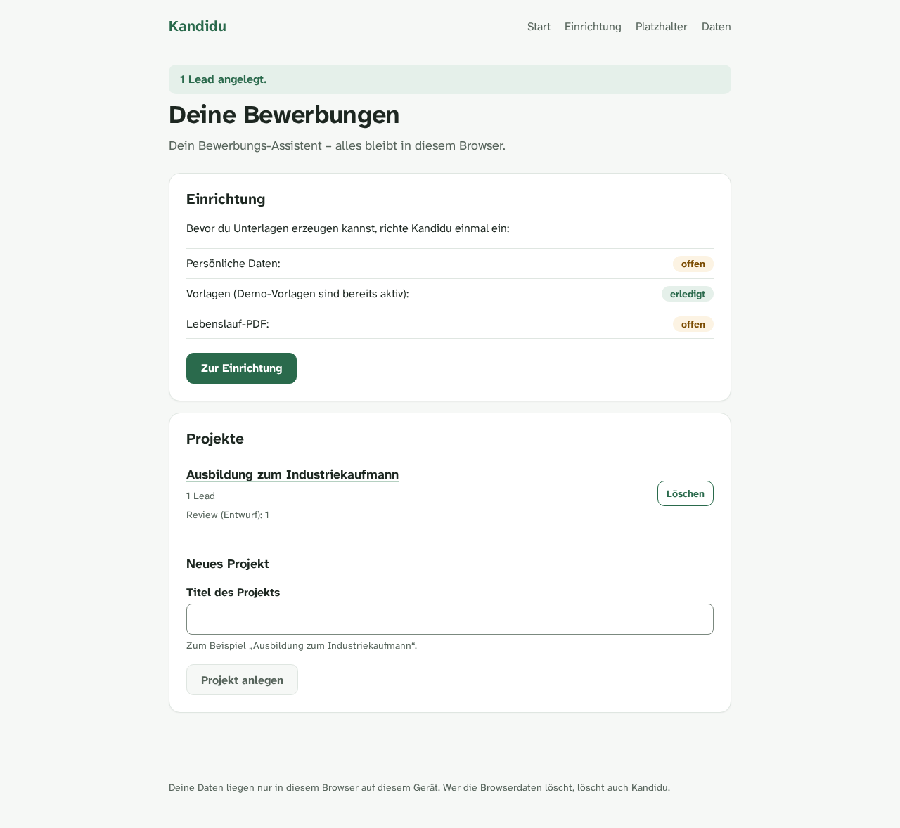 | 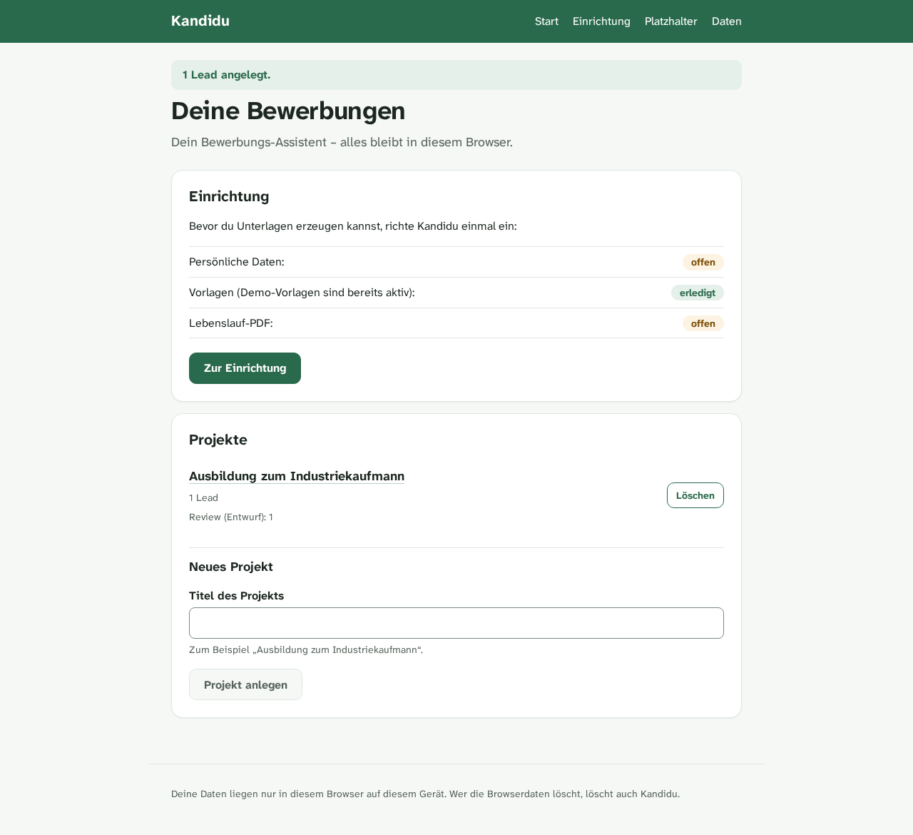 |
| Start, 360 px | 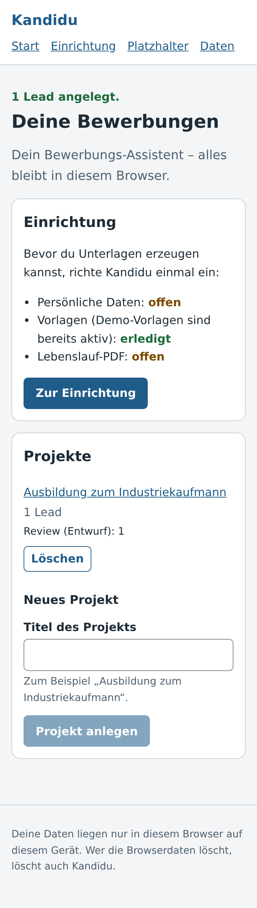 | 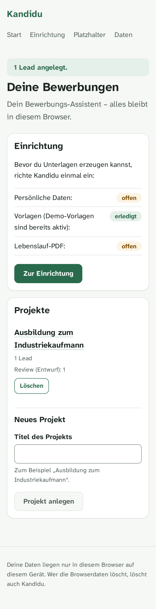 | 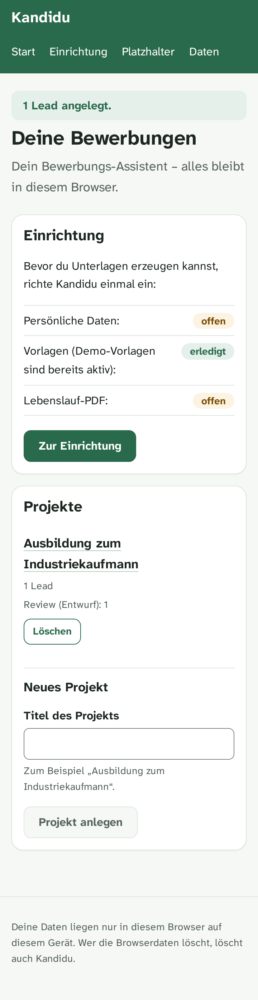 |
| Lead prüfen, Desktop | 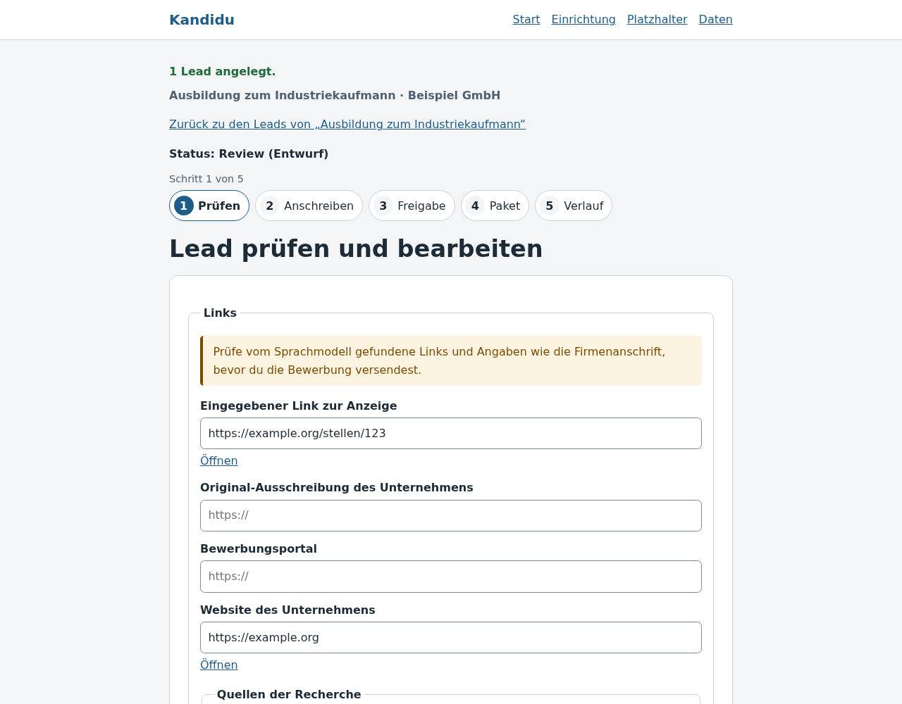 | 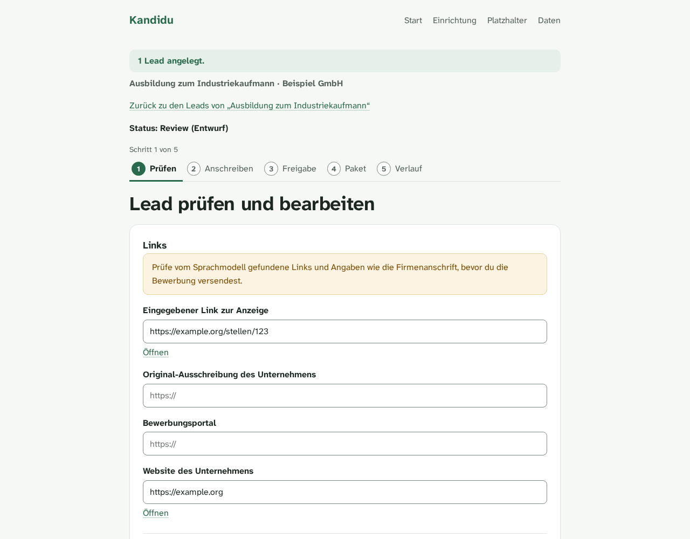 | 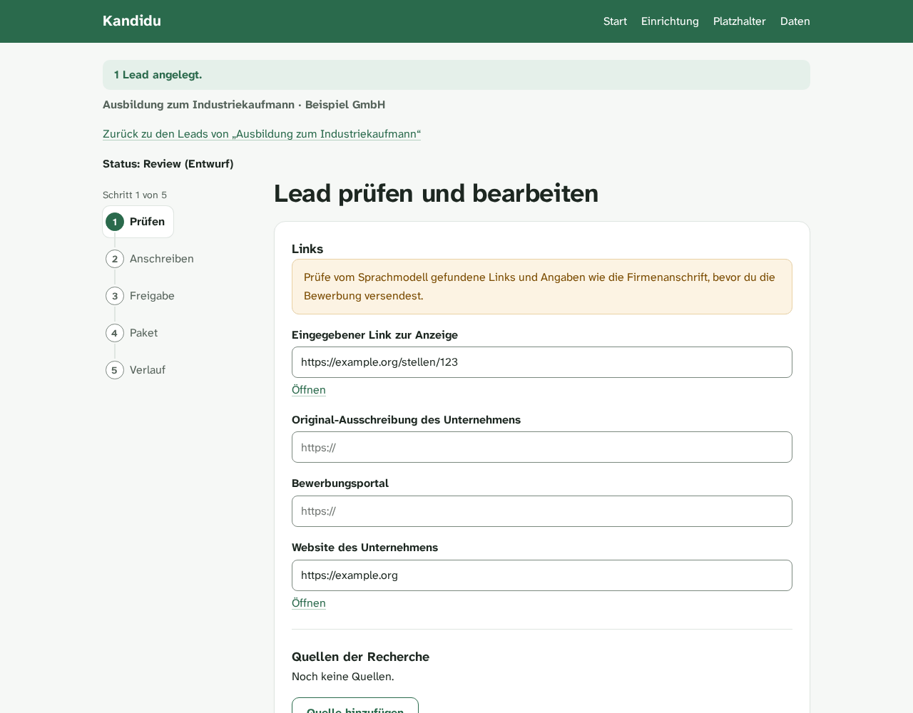 |
| Lead prüfen, 360 px | 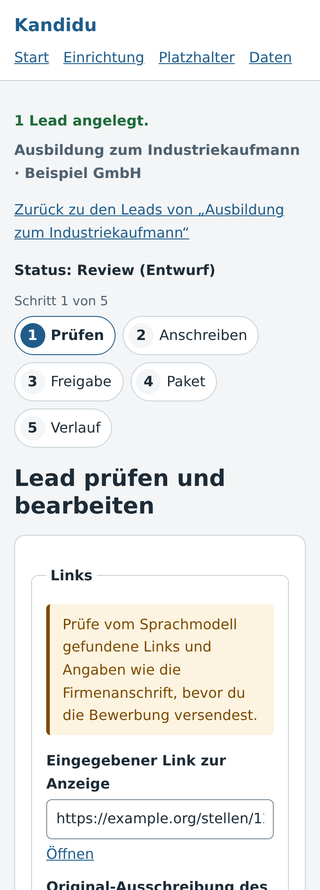 | 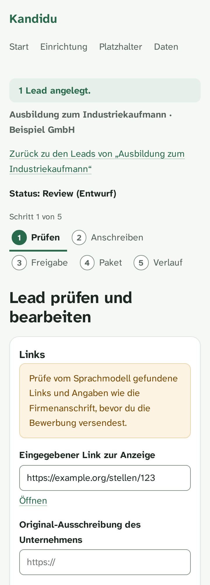 | 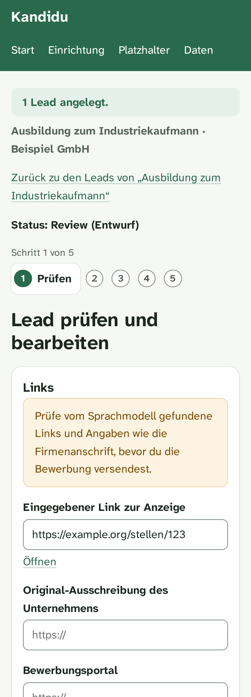 |

Leere Startseite: `img/*-home-empty-*.png`.

**Schritte (nur Testdaten)**
1. Beide Links öffnen, ein Projekt anlegen (Links → Prompt → Antwort mit Testantwort) und einen Lead öffnen; einmal am Handy oder bei 360 px.
2. Mit Tab durchgehen: Fokus ist überall sichtbar.
3. Entscheiden (unten).

**Deine Entscheidungen**
- Go mit „Ruhig“, Go mit „Geführt“ oder No-Go. Empfehlung: „Ruhig“ (ruhiger, weniger Umbau; „Geführt“ unterscheidet sich auf der Startseite nur durch die grüne Kopfzeile).
- Danach Light (US2 alle Bildschirme, US3 Lead-Liste als Karten, ein C3-Gate)?
- Selbst gehostete Schrift (ADR 011) bestätigen.

**Offene nits (design-critic, 2 Runden, keine blocker/should-fix):** Doppelpunkt hinter „Persönliche Daten:“ steht weit von der Plakette (Text bleibt unverändert); Fußzeilen-Linie breiter als die Textspalte (schon auf main).

**Antworten:** `docs/templates/gate-feedback.md` nach `specs/002-visual-design/feedback/C1.md` kopieren oder im Chat.

**Grenzen:** forced colors nur per CSS, nicht gerendert geprüft; nur Chromium. Details: `docs/STATUS.md`.
